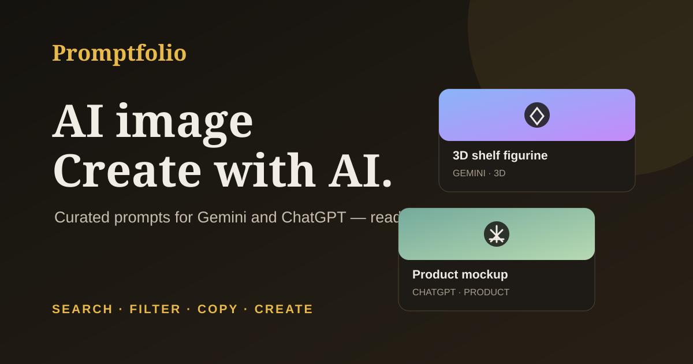

<p align="center">
  <a href="https://sandipgudle121.github.io/promptfolio/">
    
  </a>
</p>

<p align="center">
  <a href="https://sandipgudle121.github.io/promptfolio/"><strong>🌐 Visit the Promptfolio website →</strong></a>
</p>

<p align="center">
  A hand-curated library of copy-ready AI image-generation and photo-editing prompts.
  Search, filter, copy, and create with your favorite AI tools.
</p>

---

## ✨ What you can do

- Explore prompts for portraits, products, illustration, 3D scenes, travel, and more.
- Search the catalog and filter by category.
- Copy a prompt and adapt it for tools such as Gemini or ChatGPT.
- Open featured prompts for complete examples, helpful usage tips, and related prompts.
- Switch themes and browse a static catalog built with plain HTML, CSS, and JavaScript.

## 🚀 Visit the live site

**[Open Promptfolio](https://sandipgudle121.github.io/promptfolio/)**<br>
No account or installation required.

## 🧭 Table of contents

- [Add or edit a prompt](#add-or-edit-a-prompt)
- [Create a prompt detail page](#create-a-prompt-detail-page)
- [Add sample images](#add-sample-images)
- [Deploy with GitHub Pages](#deploy-with-github-pages)
- [Contributing](#contributing)
- [About the project](#about-the-project)

## Add or edit a prompt

Prompt data lives in `js/prompts-data.js`. Each item needs a title, tag, category, and prompt text. A sample image and `Featured` badge are optional. Every prompt with a sample image should also have a `seoSlug` that points to its detail page:

```js
{
  title: "Short name for the prompt",
  tag: "Studio portrait",
  category: "Portrait",
  seoSlug: "studio-portrait",
  badge: "Featured",
  image: "assets/samples/example.jpg",
  text: "The complete prompt text a person will copy."
}
```

Available categories are `Portrait`, `Product`, `Illustration`, `3D`, `Travel`, `Photo Editing`, `Graphic Design`, `Architecture`, and `Document`. Choose the closest existing category so the filters stay useful.

`Featured` is a manual editorial label, not a popularity metric. The catalog is curated by hand and does not track live trends or visitor behavior. Avoid describing prompts as trending or popular based on analytics the site does not collect.

The homepage includes a static prompt summary for visitors and crawlers when JavaScript is unavailable. Keep it up to date when adding or renaming prompts.

## Create a prompt detail page

Detail pages are hand-authored in `prompts/`. They include an introduction, the complete prompt, usage guidance, related links, and page-specific metadata.

For prompts with sample images, add a `seoSlug` and create its matching page in `prompts/`. Keep the page's prompt text aligned with `js/prompts-data.js`, and add the page's canonical URL to `sitemap.xml`.

Each detail page needs:

- A unique title, description, and canonical URL.
- Matching Open Graph and Twitter titles/descriptions, a unique absolute social image URL, and `og:url`.
- Its canonical URL in `sitemap.xml`.
- Relevant internal links and useful instructions beyond simply repeating the prompt.

Before publishing, run the consistency check:

```powershell
powershell -ExecutionPolicy Bypass -File scripts/check-seo.ps1
```

GitHub Actions runs the same check on pushes and pull requests.

## Add sample images

Put sample images in `assets/samples/`, then set the prompt's `image` path to the file. Use optimized web images where possible. When no image is supplied, Promptfolio generates a lightweight abstract preview.

## Deploy with GitHub Pages

1. Keep `index.html`, `robots.txt`, and `sitemap.xml` at the repository root so GitHub Pages can serve the static site directly. Application code is organized in `js/` and `css/`, prompt pages are in `prompts/`, and images and icons are in `assets/`.
2. In the repository, open **Settings → Pages**.
3. Under **Build and deployment**, select **Deploy from a branch**, choose `main` and `/(root)`, then save.
4. Open the published site and confirm the homepage and prompt detail pages load.

This repository is configured for **[sandipgudle121.github.io/promptfolio](https://sandipgudle121.github.io/promptfolio/)**. If the repository owner or name changes, update the canonical links, social metadata, `robots.txt`, and `sitemap.xml` to match the new URL.

## Contributing

Prompt suggestions and pull requests are welcome. See [CONTRIBUTING.md](CONTRIBUTING.md) and the prompt-submission issue template for quality and testing guidelines.

## About the project

- Promptfolio is not affiliated with Google or OpenAI.
- Search, category filters, theme selection, and prompt copying run in the browser; there is no backend.
- `Featured` reflects manual editorial selection, not visitor behavior.
